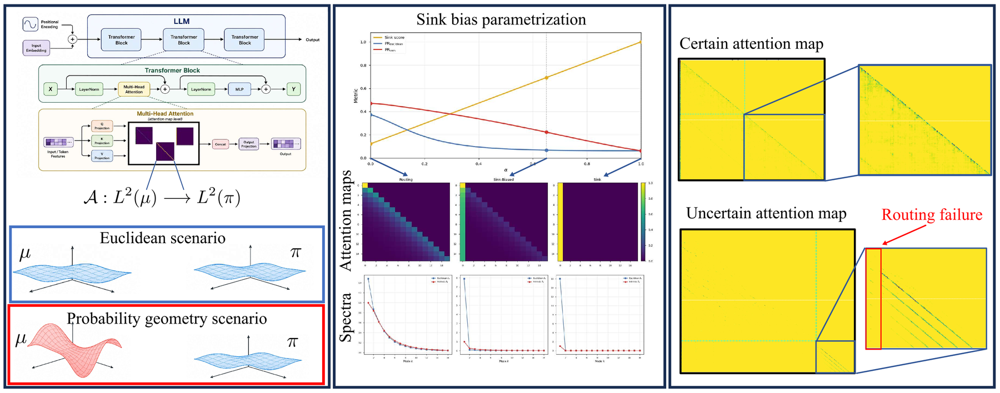
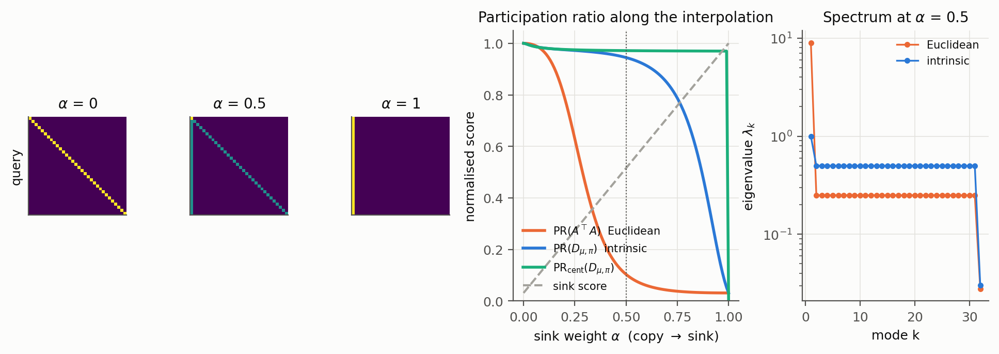
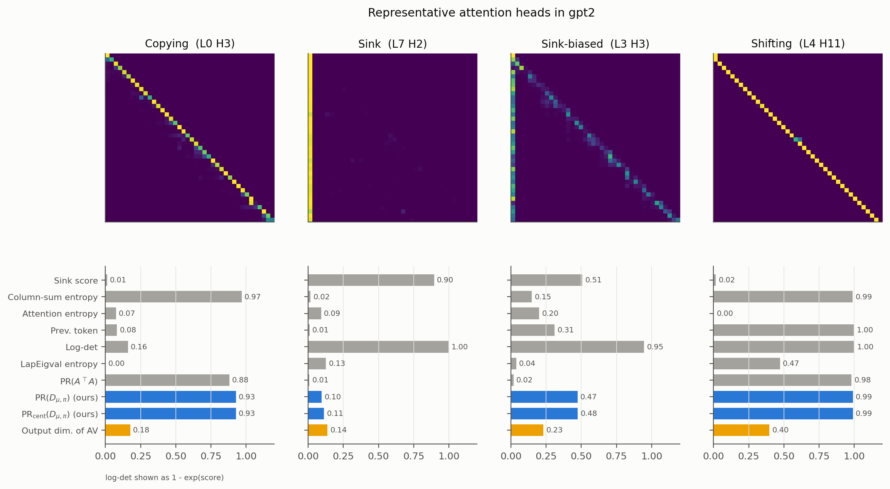
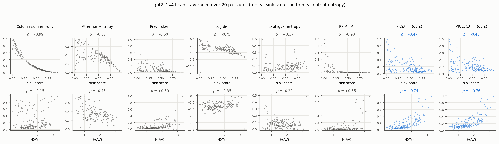

<div align="center">

# Spectral Geometry of Attention: From Information Routing to Uncertainty

**Giulio Viganò · Simone Melzi · Maks Ovsjanikov**

*NeurIPS 2026*

[](https://arxiv.org/abs/2610.06012)
[](LICENSE)



</div>

We view each attention head as a **functional map** between Hilbert spaces of functions on the token
sequence and study the spectrum of the resulting **Token Difference Operator (TDO)**. Euclidean spectra
of attention are structurally biased by sinks. They conflate mass concentration with routing capacity.
Equipping token space with the **intrinsic probability geometry** induced by attention removes this bias:
the constant mode becomes a transported mean, and the remaining spectrum measures token-dependent
routing and bounds the dimensionality of the head output. Building on this, **SAUQ** is a single-pass
uncertainty estimator that watches the routing spectrum of selected heads during generation. It
complements probability-based scores, with the largest gains on long-context summarization.

This repository contains a compact, tested implementation of the core algorithms and examples
that reproduce the paper's main phenomena. The full experimental pipeline (benchmarks, all baselines,
and paper tables) will be released separately; see [Roadmap](#roadmap).

---

## Method in a nutshell

**Token Difference Operator.** Let $A\in\mathbb R^{n\times n}$ be a causal, row-stochastic attention map
viewed as $\mathcal A: L^2(\mu)\to L^2(\pi)$, $f\mapsto Af$, for positive measures $\mu,\pi$ on token
positions. Its adjoint is $\mathcal A^*=\Omega_\mu^{-1}A^\top\Omega_\pi$ and the TDO is

$$
D_{\mu,\pi} = \mathcal A^*\mathcal A = \Omega_\mu^{-1}A^\top\Omega_\pi A .
$$

| geometry | measures | what the spectrum sees |
|---|---|---|
| Euclidean | $\mu=\pi=\mathbf 1$ | $D=A^\top A$, $\sigma_1(A)\ge 1$; a causal sink gives $\sigma_1^2=n$ (**sink bias**, Prop. 1) |
| **intrinsic** | $\pi=\tfrac1n\mathbf 1,\ \mu=A^\top\pi$ | non-expansive, $\lambda_1(D)=1$ on the constant mode (Prop. 2); routing lives on the $\mu$-centered subspace |

In the intrinsic geometry the head output splits as $AV=\mathbf 1 m + AV_c$, a transported mean plus a
routed part with $\lVert AV_c\rVert_{\pi,F}\le\sqrt{\lambda_2(D)}\,\lVert V_c\rVert_{\mu,F}$ (Prop. 3), and
the spectrum bounds the spectral entropy of the output (Cor. 2). We summarise the spectrum by the
normalised participation ratio

$$
\mathrm{PR}(D_{\mu,\pi}) = \frac1n\,\frac{\operatorname{tr}(D)^2}{\operatorname{tr}(D^2)} \in \Big[\tfrac1n,1\Big],
$$

which needs only $\operatorname{tr}(S)$ and $\lVert S\rVert_F^2$ of the symmetric matrix
$S=\Omega_\mu^{-1/2}A^\top\Omega_\pi A\,\Omega_\mu^{-1/2}$, with no eigendecomposition.

**SAUQ.** For each layer $l$ in the middle third of the network:

1. **Head selection.** On the generated-token block $B$ of the final step, pick
   $h^*=\arg\max_h \mathrm{PR}(B_hB_h^\top)$ with one batched product over all heads.
2. **Routing signal.** At every decoding step $t$, on the selected head's attention over the whole prefix,
   $s_t=\mathrm{PR}(D_{\mu_t,\pi_t})$ with intrinsic measures. This is computed incrementally in $O(n^2)$ per step.
3. **Confidence recurrence** (as in RAUQ): $c_1=p_1$, $c_t=\alpha p_t+(1-\alpha)\,s_t\,c_{t-1}$, with $\alpha=0.2$.
4. $U^{(l)}=1-\frac1T\sum_t\log c_t$, and $U_{\mathrm{SAUQ}}=\max_l U^{(l)}$.

Collapsed routing ($s_t\to 0$) stops confidence from propagating, so the uncertainty rises.

---

## Installation

```bash
git clone https://github.com/gviga/spectral-geometry-attention.git
cd spectral-geometry-attention
pip install -e ".[examples]"      # core needs only numpy + scipy
```

Hugging Face models must be loaded with `attn_implementation="eager"`. Fused kernels (SDPA, Flash)
do not return attention weights.

## Quickstart

**Spectral diagnostics of one attention map**

```python
import numpy as np
from spectral_attention import synthetic as syn
from spectral_attention import tdo_pr, tdo_pr_centered, tdo_spectrum

n = 32
A = syn.interpolate(syn.copy_map(n), syn.sink_map(n), 0.5)   # every token still copies itself

tdo_pr(A, "euclidean")   # 0.10  -> looks collapsed: sink bias
tdo_pr(A)                # 0.95  -> intrinsic geometry: routing is intact
tdo_spectrum(A)[0]       # 1.0   -> the trivial constant mode
```

**SAUQ for a generation**

```python
import torch
from transformers import AutoModelForCausalLM, AutoTokenizer
from spectral_attention.hf import greedy_generate, sauq_for_generation

name = "Qwen/Qwen2.5-0.5B-Instruct"
tok = AutoTokenizer.from_pretrained(name)
model = AutoModelForCausalLM.from_pretrained(name, attn_implementation="eager").cuda().eval()

prompt_ids, gen_ids, logprobs = greedy_generate(model, tok, "Who discovered penicillin?", chat=True)
uncertainty, details = sauq_for_generation(model, prompt_ids, gen_ids, logprobs, alpha=0.2)
# details[layer] = {"head": selected head, "signal": s_t per step, "uncertainty": U^(l)}
```

`sauq_score(attentions, prompt_len, token_logprobs)` in
[spectral_attention/sauq.py](spectral_attention/sauq.py) does the same from attention arrays you
already have, with no framework dependency.

## Examples

All scripts run on a laptop GPU and write to [figures/](figures/).

| script | paper | what it shows |
|---|---|---|
| [01_sink_bias.py](examples/01_sink_bias.py) | Sec. 3, teaser | copy→sink interpolation: Euclidean vs intrinsic PR and spectra |
| [02_representative_heads.py](examples/02_representative_heads.py) | Fig. 3 | copying / sink / sink-biased / shifting heads scored by every diagnostic |
| [03_sink_vs_output_dimensionality.py](examples/03_sink_vs_output_dimensionality.py) | Fig. 4 | all heads: diagnostics vs sink score and vs output entropy $H(AV)$ |
| [04_sauq_quickstart.py](examples/04_sauq_quickstart.py) | Sec. 5 | SAUQ on trivia questions, with signal and confidence traces |

```bash
python examples/01_sink_bias.py
python examples/02_representative_heads.py --model gpt2          # paper: meta-llama/Llama-3.1-8B
python examples/03_sink_vs_output_dimensionality.py --model gpt2 --n-texts 20
python examples/04_sauq_quickstart.py --model Qwen/Qwen2.5-0.5B-Instruct
```

**Sink bias on synthetic maps.** With half of every row's mass moved onto the first token, the
Euclidean spectrum collapses while every token is still routed to itself. The intrinsic PR only
collapses when routing does.



**Representative heads (GPT-2).** The sink-biased head has the same Euclidean PR as a true sink
(0.02 vs 0.01). The intrinsic PR separates them (0.47 vs 0.10), in line with its output dimensionality.



**Across all 144 GPT-2 heads.** The intrinsic PR depends much less on the sink score than raw
attention statistics and PR(AᵀA) (|ρ| ≈ 0.4–0.5 vs up to 0.99). Only the LapEigval entropy is less
sink-dependent, as the paper also observes. The intrinsic PR tracks the output entropy $H(AV)$ best
(ρ ≈ 0.75 vs ≤ 0.50).



## Using SAUQ in LM-Polygraph

SAUQ ships as an external plug-in for [LM-Polygraph](https://github.com/IINemo/lm-polygraph), so no
fork is needed. A stat calculator runs one teacher-forced forward pass per instance and keeps only the
selected head and its signal per layer. The estimator then runs the recurrence.

```python
from spectral_attention.lm_polygraph import SAUQSignalCalculator, SAUQ
```

With `polygraph_eval`, copy the two files in [configs/lm_polygraph/](configs/lm_polygraph/) into
LM-Polygraph's `examples/configs/{stat_calculators,estimators}/` and select them:

```yaml
defaults:
  - model: llama-3.1-8b             # its load script must pass attn_implementation="eager"
  - estimators: sauq                # SAUQ + RAUQ + probability baselines
  - stat_calculators: sauq_calculators
```

The calculator re-tokenizes each instance on its own, so its attention never contains padding or
attention from another instance. You can therefore set `output_attentions: false` on the default
`GreedyProbsCalculator` to save memory when no other estimator needs attention.

## Results

Normalized PRR (higher is better) on LLaMA-3.1-8B. The full table, with 17 baselines, Qwen2.5-7B and
confidence intervals, is in the paper.

| Estimator | TriviaQA | TruthfulQA | MMLU | CoQA | QA mean | SAMSum | XSum | Summ. mean |
|---|---|---|---|---|---|---|---|---|
| Perplexity | 0.109 | 0.286 | 0.516 | 0.274 | 0.296 | 0.507 | 0.405 | 0.456 |
| MeanTokenEntropy | 0.566 | **0.420** | 0.244 | 0.257 | 0.372 | 0.500 | 0.393 | 0.446 |
| NLI-EigValLaplacian (10 samples) | **0.603** | 0.196 | 0.468 | **0.415** | **0.421** | 0.386 | 0.385 | 0.386 |
| RAUQ | 0.263 | 0.337 | **0.560** | 0.311 | 0.368 | 0.527 | 0.301 | 0.414 |
| SAUQ (gen. only) | 0.501 | 0.306 | 0.538 | 0.311 | 0.414 | 0.495 | 0.258 | 0.376 |
| **SAUQ** | 0.291 | 0.377 | 0.559 | 0.306 | 0.383 | **0.592** | **0.421** | **0.507** |

## Implementation notes

* **Indexing.** Position $P+t-1$ is the query that predicts generated token $y_t$. The step-$t$
  signal uses the prefix $A[:P+t,\,:P+t]$; head selection and the generation-only variant use the
  rows that produced $y_0,\dots,y_{T-1}$ restricted to generated keys.
* **Fidelity to the paper runs.** Head selection and the generation-only signal match the code used
  for the paper to numerical precision. The intrinsic signal is computed from a clean teacher-forced attention matrix.
  The original pipeline carried one extra all-on-first-token row in the prompt+generation matrix (an
  artifact of how per-step attention was stitched from `generate`). On GPT-2 the resulting SAUQ scores
  differ by at most 0.5% with identical rankings (Spearman 1.0).
* **Tests.** [tests/test_tdo.py](tests/test_tdo.py) checks Propositions 1–3 and Corollaries 1–2
  numerically. [tests/test_sauq.py](tests/test_sauq.py) checks the incremental $O(n^2)$ updates
  against direct computation on every prefix. Run `pytest tests`.

## Repository structure

```
spectral_attention/
├── tdo.py            # measures, TDO, weighted SVD, PR / centered PR, mean–routing decomposition
├── diagnostics.py    # per-head baselines: sink, prev-token, entropies, log-det, LapEigval, PR(AᵀA)
├── sauq.py           # head selection, incremental routing signals, recurrence, score (numpy only)
├── hf.py             # Hugging Face: attention maps, head outputs AV, greedy generation, SAUQ
├── synthetic.py      # copy / sink / shift / local / random causal attention maps
└── lm_polygraph/     # LM-Polygraph stat calculator + estimator
configs/lm_polygraph/ # polygraph_eval configs
examples/             # the four scripts above
tests/                # numerical checks of the theory and of the fast paths
```

## Roadmap

- [x] Core TDO / intrinsic-geometry spectral tools
- [x] SAUQ (standalone + LM-Polygraph plug-in)
- [x] Examples for Sections 3–5
- [ ] Full benchmark configs and scripts to reproduce the uncertainty tables (LLaMA-3.1-8B, Qwen2.5-7B)
- [ ] Measure ablation (uniform, positional, Zipf, unembedding, intrinsic)
- [ ] Supervised spectral probes

## Citation

```bibtex
@misc{viganò2026spectralgeometryattentioninformation,
      title={Spectral Geometry of Attention: From Information Routing to Uncertainty},
      author={Giulio Viganò and Simone Melzi and Maks Ovsjanikov},
      year={2026},
      eprint={2610.06012},
      archivePrefix={arXiv},
      primaryClass={cs.LG},
      url={https://arxiv.org/abs/2610.06012},
}
```

## Acknowledgements

This work was supported by the ERC Consolidator Grant 101087347 (VEGA), the ANR AI Chair AIGRETTE, and
by gifts from Ansys and Adobe Research. The MUR supported this work with the grant "Dipartimenti di
Eccellenza 2023-2027" REGAINS of the Department of Informatics, Systems and Communication of the
University of Milano-Bicocca. SAUQ builds on the recurrence of
[RAUQ](https://arxiv.org/abs/2505.20045) and is evaluated with
[LM-Polygraph](https://github.com/IINemo/lm-polygraph).
